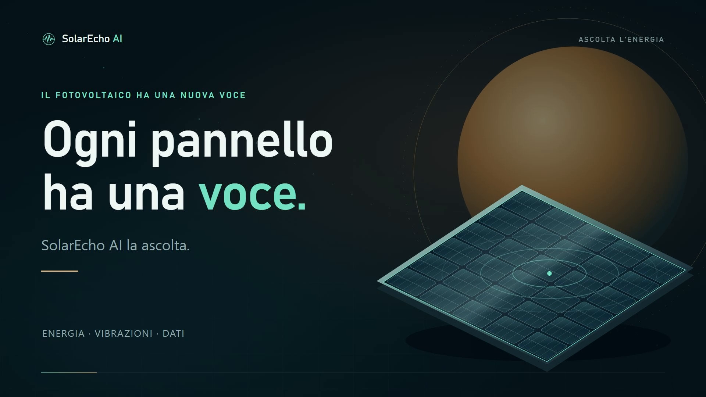
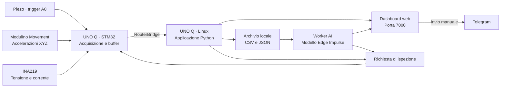

# ☀️ SolarEcho AI

<p align="center"><strong>Ascolta l’energia.</strong><br>Acquisizione vibrazionale, monitoraggio elettrico e analisi locale per un prototipo fotovoltaico.</p>



<p align="center">
  <strong>Arduino UNO Q</strong> · Python · C++ · Web UI · Edge Impulse<br>
  <a href="#avvio-rapido">Avvio rapido</a> ·
  <a href="#dashboard">Dashboard</a> ·
  <a href="#dataset-e-ai">Dataset e AI</a> ·
  <a href="#documentazione">Documentazione</a> ·
  <a href="#video-e-materiali-di-presentazione">Video demo</a>
</p>

---

## English overview

**SolarEcho AI explores condition monitoring for photovoltaic panels, helping
plant operators and maintenance technicians identify changes worth inspecting.**
A piezo sensor triggers each capture; a Modulino Movement records XYZ
acceleration. Arduino UNO Q handles acquisition on its microcontroller and
runs anomaly inference locally on Linux. A web dashboard combines vibration
records with INA219 electrical measurements and supports manual Telegram reports.

The recorded demo shows controlled ball impacts, captured waveforms, local AI
scores, a visible alert and a manually sent report. A clearly labelled synthetic
stress test demonstrates the software response to an altered signal. Detecting
real mechanical changes reliably remains to be validated; anomaly scores do
not establish damage or microcracks. Inference can operate offline once the
required model and dependencies are installed; Telegram requires Internet access.

[Demo and evidence](docs/DEMO_E_RISULTATI.md) · [Model card](docs/MODEL_CARD.md) ·
[Hardware schematic](docs/hardware/design/SolarEcho-AI-schematic_schem.jpg)

## Il progetto

**SolarEcho AI** studia la risposta meccanica di un pannello fotovoltaico dopo impatti controllati. Il piezo rileva il trigger, l’IMU registra le accelerazioni sui tre assi e l’UNO Q conserva i dati per confrontare la firma vibrazionale con una baseline normale. Un INA219 affianca le acquisizioni con misure di tensione, corrente e potenza.

Il repository contiene il firmware, l’applicazione Python per Arduino App Lab, la dashboard web, strumenti di preparazione dei dataset, test software, documentazione tecnica, un involucro CAD e un progetto video Remotion.

> **Prototipo sperimentale.** Un’anomalia segnala una variazione da ispezionare: non certifica microfratture o danni. La validazione del modello su alterazioni meccaniche reali resta da completare. Luce, ombra, carico e montaggio possono influenzare i confronti.

## Funzioni e stato

| Area | Cosa offre il codice | Stato documentato |
| --- | --- | --- |
| Acquisizione | Trigger piezo su A0, IMU XYZ, buffer prima/dopo l’impatto, CSV e JSON per evento | Acquisizioni reali presenti nei dataset; qualità e frequenza da controllare per ogni prova |
| Dashboard | Quattro schede, telemetria, grafici, archivi e download | Versione iniziale e storico elettrico provati dal team; riorganizzazione grafica da verificare |
| AI locale | Modello personalizzato, score, soglia configurabile, storico e confronto sintetico | Integrazione implementata; verifica sul banco e validazione sperimentale da completare |
| Energia e costi | Riferimento elettrico, confronto temporale, energia integrata e scenario domestico | Calcoli implementati; scenario economico esplicitamente ipotetico |
| Ispezione | Allerta persistente, LED D7 e LED RGB 3 integrato, reset manuale | Percorso completo da verificare sul banco |
| Telegram | Anteprima, invio manuale e report persistenti | Integrazione provata dal team; aggiunta dei dati AI da verificare |
| Esportazione | CSV uniformi per Edge Impulse e report delle esclusioni | Lotti esportati presenti; test del convertitore superati nella verifica locale descritta sotto |

Le guide in `docs/` registrano anche fasi precedenti dello sviluppo. La
[pagina Demo e risultati](docs/DEMO_E_RISULTATI.md) distingue le evidenze raccolte
dalle validazioni ancora aperte; la [scheda del modello](docs/MODEL_CARD.md)
riassume dati, input e limiti. Per l'avvio consultare
[l’integrazione AI](docs/AI_INTEGRAZIONE.md). Il promo storico di 45 secondi
descrive ancora il modello come non attivo; i montaggi successivi mostrano
l'integrazione sperimentale.

## Come funziona



1. Il firmware mantiene gli ultimi **200 ms** di accelerazione e, al trigger piezo, acquisisce altri **2 s**.
2. Terminata la cattura, trasferisce il buffer a Python tramite Bridge. Durante il trasferimento gli impatti non vengono monitorati.
3. Python salva una coppia CSV/JSON, verifica la qualità e conferma il salvataggio prima del riarmo. Le catture incomplete vengono conservate con i motivi di esclusione.
4. Un worker separato analizza gli eventi salvati: l’inferenza non blocca la conferma del CSV. La dashboard mostra misure, archivi ed esiti.

La telemetria web è un’anteprima, pubblicata al massimo a **1 Hz** quando il firmware è in stato IDLE. La forma d’onda completa si consulta dai dati dell’evento.

## Hardware

| Componente | Ruolo e collegamento nel firmware |
| --- | --- |
| **Arduino UNO Q** | STM32 per acquisizione; ambiente Linux/App Lab per Python, dashboard e modello |
| **Modulino Movement** | Accelerazioni X/Y/Z in `g`; connettore Qwiic, bus `Wire1` |
| **Piezo analogico condizionato** | Trigger e diagnostica su A0; ingresso protetto nel dominio 0–3,3 V |
| **INA219 con shunt R100** | Tensione, corrente e potenza; SDA/SCL su `Wire`, indirizzo configurato `0x40`, shunt `0,1 Ω` |
| **LED rosso esterno** | D7 → resistenza 1 kΩ → anodo; catodo → GND |
| **LED RGB 3 integrato** | Il canale rosso replica l’allerta |

**Prima dei collegamenti**, seguire [la guida piezo](docs/ACQUISIZIONE_E_SENSORI.md#piezo-analogico-e-protezione) e [la guida INA219](docs/ACQUISIZIONE_E_SENSORI.md#ina219-e-misura-elettrica). Una sola resistenza da 1 MΩ in parallelo al piezo non protegge l’ADC. Il modulo Grove Piezo elencato nell’inventario ha un’uscita HIGH/LOW: non va confuso con un elemento piezo analogico grezzo.

OLED, sensore ACS70331, batteria e caricatore solare sono documentati nell’inventario, ma non costituiscono il percorso di acquisizione implementato in questo firmware. Modelli fisici, alimentazione e cablaggio vanno confermati seguendo [Componenti](docs/COMPONENTI.md).

Materiali disponibili: [schema Fritzing](docs/hardware/design/SolarEcho-AI-schematic.fzz), [vista breadboard](docs/hardware/design/SolarEcho-AI-schematic_bb.jpg), [schema elettrico](docs/hardware/design/SolarEcho-AI-schematic_schem.jpg), [distinta elettronica](docs/hardware/design/SolarEcho-AI-eBOM.xlsx) e [involucro STL](Solar_Housing.stl). Per i pin dell’UNO Q usare il [pinout dedicato](docs/hardware/datasheets/ABX00162-full-pinout.pdf).

## Avvio rapido

### Prerequisiti

- UNO Q configurata in **Arduino App Lab**, collegamento USB-C dati e sensori preparati secondo le guide.
- PC e scheda raggiungibili sulla stessa rete per aprire la dashboard.
- **PowerShell 5.1 o successivo** e ADB disponibile per il deploy USB; SSH/SCP per l’alternativa di rete.
- Modello **`ei-model-1136239-1`**, progetto Edge Impulse **1136239**, già scaricato in App Lab.
- Token Telegram configurato sulla scheda se si usa il bot; Internet per Telegram e per scaricare inizialmente modello e dipendenze.

Il runtime Arduino e i brick sono gestiti da App Lab tramite [app.yaml](app/app.yaml). L’applicazione completa va eseguita nell’ambiente della scheda; non è previsto un avvio autonomo con `python app/python/main.py` sul PC.

### 1. Trasferisci il codice

Dalla radice del repository, con UNO Q collegata:

```powershell
# Anteprima: controlla collegamento e destinazione.
.\deploy.ps1 -WhatIf

# Trasferimento delle sorgenti.
.\deploy.ps1
```

Lo script trasferisce i file elencati al suo interno in `/home/arduino/ArduinoApps/solarecho-ai`, arresta SolarEcho se è attiva, conserva un backup dei sorgenti precedenti e confronta i checksum **SHA256**. I dati in `data/` vengono conservati.

<details>
<summary><strong>Alternative di deploy</strong></summary>

```powershell
# ADB in un percorso specifico.
.\deploy.ps1 -AdbPath 'C:\percorso\adb.exe'

# Più dispositivi USB: sostituire con il seriale effettivo.
.\deploy.ps1 -Serial '<seriale-UNO-Q>'

# Via rete: sostituire con il nome o l’IP effettivo della scheda.
.\deploy.ps1 -SshHost arduino@solarecho-unoq.local

# Se l’execution policy blocca lo script, limitare la modifica al processo.
powershell.exe -NoProfile -ExecutionPolicy Bypass -File .\deploy.ps1
```

L’opzione `-Start` trasferisce e avvia anche l’app, ma richiede che le altre app siano ferme. Per riconfigurare Telegram dopo il deploy usare il trasferimento senza `-Start`, impostare il token e avviare da App Lab. Dettagli in [Deploy](docs/DEPLOY.md).

</details>

### 2. Configura e avvia in App Lab

1. Torna all’elenco delle app e riapri **SolarEcho-AI**, così l’editor ricarica le sorgenti trasferite.
2. Controlla il modello personalizzato nel brick **Vibration Anomaly Detection**.
3. Configura `TELEGRAM_BOT_TOKEN` nel campo del brick **Telegram Bot** dopo il deploy: lo script sostituisce il manifest con quello privo di credenziali. Conserva il token sulla scheda.
4. Premi **Run** e attendi **READY** per l’acquisizione e **MODELLO PRONTO** per l’AI.
5. Apri **`http://<IP-della-UNO-Q>:7000`** sulla rete locale. Dopo un aggiornamento degli asset usa **Ctrl+F5**.
6. Nella dashboard inserisci e salva la **soglia usata in Edge Impulse**. Senza soglia salvata il modello calcola lo score, ma non genera allerte AI.

### 3. Esegui la prima acquisizione

Fissa sensore, posizione e orientamento; mantieni ripetibili pallina, altezza e punto di caduta. Attendi **READY**, esegui un solo impatto, poi aspetta il salvataggio e il successivo READY. Controlla `capture_complete=True` nel JSON e osserva il grafico prima di usare l’evento come baseline.

La procedura completa è in [Prima acquisizione](docs/ACQUISIZIONE_E_SENSORI.md#prima-acquisizione). Gli strumenti di export sul PC richiedono **Python 3.9+**, con la sola libreria standard.

## Dashboard

| Scheda | Contenuti principali |
| --- | --- |
| **Panoramica** | Stato acquisizione, misure recenti, contatori e allerta |
| **Vibrazioni e AI** | Eventi salvati, grafici, download CSV/JSON, score, rianalisi e test sintetico |
| **Energia e costi** | Storico elettrico, riferimento su 10 letture valide, confronto e scenario economico |
| **Segnalazioni** | Destinatario Telegram, anteprima, invio manuale e storico dei report |

L’energia viene integrata soltanto sugli intervalli coperti da misure valide; i buchi non vengono ricostruiti come produzione misurata. Produzione domestica, tariffe e proiezioni economiche sono parametri di uno **scenario ipotetico**.

L’allerta rimane memorizzata fino a **Conferma / reset allerta**. Il test sintetico usa il motivo `AI_TEST`; un’anomalia reale usa `AI_ANOMALY`. LED e allerte non inviano automaticamente Telegram: l’invio parte dal pulsante **Invia segnalazione**.

Per Telegram, avvia la chat privata con `/start`, copia il **Chat ID** ricevuto nella dashboard e salva il destinatario. Il Chat ID è distinto dal token. Guide: [Dashboard](docs/DASHBOARD.md), [Energia e costi](docs/DEMO_ECONOMICA.md), [LED](docs/DASHBOARD.md#allerte-e-led), [Telegram](docs/TELEGRAM.md).

## Dataset e AI

### Contratto dei segnali

| Percorso | Frequenza / campioni | Finestra relativa al trigger |
| --- | --- | --- |
| Acquisizione grezza | IMU nominale ~104 Hz; frequenza effettiva nei metadati | −200 ms / +2000 ms |
| Inferenza AI corrente | **100 Hz · 200 campioni XYZ · 600 valori in g** | **[−150, +1850) ms** |
| Export predefinito del convertitore | **100 Hz · 200 campioni XYZ · 600 valori in g** | **[−150, +1850) ms** |
| Lotti demo già presenti | 100 Hz · 200 campioni XYZ | [−150, +1850) ms |

**Export e inferenza condividono configurazione, controlli di qualità e ricampionamento** in [signal_processing.py](app/python/signal_processing.py). Il valore predefinito è già coerente con il modello corrente: non serve specificare `--end-ms 1850`. I lotti storici da 210 campioni restano invariati e la loro finestra si riproduce specificando `--end-ms 1950`. Il ricampionamento è lineare, senza estrapolazione, sottrazione dell’offset o normalizzazione dell’ampiezza; non è un filtro antialias.

Lo score di anomalia non è una percentuale né una probabilità e può essere negativo. Il confronto implementato è `score >= soglia`. La soglia della dashboard deve essere aggiornata manualmente se cambia quella nello Studio.

### Esportazione ripetibile

Copia dal dispositivo **CSV e JSON insieme**, poi separa eventi normali, modificati e ripristinati sulla base delle condizioni annotate dall’operatore. Usa cartelle di output nuove: i nomi `readme_*` seguenti distinguono l’esempio dai lotti già presenti.

```powershell
# Training normale, con la finestra del modello corrente.
python tools/export_edge_impulse.py --input datasets/raw/demo_normal_training --output datasets/edge_impulse/readme_training_v1 --label normal --split training

# Eventi normali separati per il test.
python tools/export_edge_impulse.py --input datasets/raw/demo_normal_test --output datasets/edge_impulse/readme_test_v1 --label normal --split test

# Copie sintetiche del lotto di test, in una nuova cartella.
python tools/generate_synthetic_impacts.py --input datasets/edge_impulse/readme_test_v1 --output datasets/edge_impulse/readme_synthetic_v1 --profile stress
```

L’esportatore produce `timestamp,accX,accY,accZ`, un CSV per evento e un `export_report.json` con hash, condizioni e motivi di esclusione. Codici di uscita: **0** tutti esportati, **1** almeno un evento escluso, **2** errore di comando o scrittura. Non effettua upload.

Mantieni separati **training, calibrazione e test**, senza condividere lo stesso evento fra gruppi. Per le metriche di anomaly detection nello Studio le etichette di upload sono `no anomaly` e `anomaly`; i nomi locali `normal`/`modified` conservano la provenienza nel report.

### Lotti inclusi

Conteggi ricavati dai report presenti nel repository, alla verifica dell’11 ottobre 2026:

| Lotto in `datasets/edge_impulse/` | Eventi / copie | Durata | Utilizzo |
| --- | ---: | ---: | --- |
| `normal_training_v1` | 42 | 2,1 s | Training normale |
| `normal_test_v1` | 8 | 2,1 s | Test normale |
| `modified_test_v1` | 8 | 2,1 s | Test con modifica meccanica |
| `restored_test_v1` | 6 | 2,1 s | Test dopo ripristino, etichetta normale |
| `demo_training_v1` | 18 | 2 s | Training demo |
| `demo_calibration_v1` | 5 | 2 s | Calibrazione demo |
| `demo_test_v1` | 5 | 2 s | Test demo |
| `demo_synthetic_v1` | 15 copie da 5 eventi | 2 s | Perturbazioni moderate |
| `demo_synthetic_stress_v1` | 5 copie da 5 eventi | 2 s | Oscillazioni persistenti |

I conteggi descrivono i dati, non l’accuratezza del modello. Le copie sintetiche sono correlate ai loro originali e non valgono come impatti fisici indipendenti. Il profilo `stress` aggiunge oscillazioni di 0,35 g a 8/17/29 Hz su X/Y/Z dopo il trigger, con rampa di 50 ms; non simula un danno fisico validato.

Guide: [Export Edge Impulse](docs/EDGE_IMPULSE_EXPORT.md), [Integrazione AI](docs/AI_INTEGRAZIONE.md), [Test sintetici](docs/AI_INTEGRAZIONE.md#test-sintetici-offline), [Verifica delle condizioni reali](docs/archive/tests/VERIFICA_TEST_20261010.md).

## Struttura del repository

```text
SolarEcho-AI/
├── app/
│   ├── app.yaml                 # Porta 7000, brick e modello personalizzato
│   ├── sketch/                  # Firmware STM32 e monitor INA219
│   ├── python/                  # Logger, dashboard, AI, energia e Telegram
│   └── assets/                  # Interfaccia HTML, CSS e JavaScript
├── datasets/
│   ├── raw/                     # Acquisizioni originali CSV + JSON
│   ├── edge_impulse/            # Lotti esportati, sintetici e report
│   ├── manifests/               # Provenienza e report storici degli split
│   └── rejected/               # Archivi di acquisizioni scartate
├── docs/                        # Guide operative e specifica SRS
│   ├── hardware/                # Manuale, datasheet e progettazione
│   └── archive/                 # Verifiche datate e manifest del riordino
├── tests/                       # Test Python con dati e servizi simulati
├── tools/                       # Export e generatore di perturbazioni
├── presentation/              # Tutti i sorgenti e i materiali video
│   ├── materials/               # Foto e riprese originali del team
│   ├── docs/                    # Guida al video corrente e archivio
│   └── tools/                   # Preparazione risorse e verifiche video
├── video_output/                # Render e intermedi locali, esclusi da Git
├── Solar_Housing.stl             # Involucro CAD
└── deploy.ps1                   # Trasferimento USB/ADB oppure SSH/SCP
```

Indici: [documentazione](docs/README.md), [dataset e provenienza](datasets/README.md),
[materiali video](presentation/README.md). I vecchi percorsi e le copie
deduplicate sono documentati nel [manifest del riordino](docs/archive/REPOSITORY_CLEANUP_20261017.json).

<details>
<summary><strong>Moduli Python principali</strong></summary>

| Modulo | Responsabilità |
| --- | --- |
| [main.py](app/python/main.py) | Avvio App Lab, callback Bridge e collegamento dei servizi |
| [event_logger.py](app/python/event_logger.py) | Protocollo eventi, timeout, qualità, salvataggio e ACK senza dipendenze Arduino |
| [signal_processing.py](app/python/signal_processing.py) | Configurazione e preprocessing condivisi da export e inferenza |
| [dashboard.py](app/python/dashboard.py) | Web UI, telemetria e API HTTP |
| [power_history.py](app/python/power_history.py) | Storico elettrico per sessione |
| [vibration_ai.py](app/python/vibration_ai.py) | Preparazione input, worker del modello e report |
| [electrical_demo.py](app/python/electrical_demo.py) | Riferimento, energia e scenario economico |
| [inspection_alert.py](app/python/inspection_alert.py) | Condizioni d’allerta, persistenza e reset |
| [telegram_notifications.py](app/python/telegram_notifications.py) | Invio manuale, esiti e report |

</details>

### Dati persistenti sulla scheda

Questi percorsi sono relativi alla cartella dell’app sull’UNO Q:

```text
data/
├── raw/                         # <sessione>_event_<id>.csv + .json
├── power/                       # CSV dello storico elettrico per sessione
├── ai/
│   ├── settings.json            # Soglia e abilitazione allerte AI
│   ├── inferences.csv           # Storico compatto
│   └── result_<id>.json          # Esiti, segnali e provenienza
├── analysis/                    # Report economici e inspection_alert.json
└── notifications/               # Impostazioni e notification_<id>.json
```

`app/data/` è esclusa da Git. I timestamp del CSV grezzo sono in microsecondi e relativi al trigger; il JSON distingue `transport_complete` da `capture_complete` e conserva la frequenza effettiva e i motivi di esclusione.

## Verifiche software

Dalla radice del repository:

```powershell
python -B -m unittest discover -s tests -v
```

**Esecuzione storica del 15 ottobre 2026, Python 3.11 (prima del refactoring):** 35 test eseguiti, **28 superati e 7 errori**. I conteggi seguenti non descrivono la suite aggiornata.

| Gruppo | Esito osservato |
| --- | --- |
| Export Edge Impulse | 8/8 superati |
| Demo elettrica | 5/5 superati |
| Allerta di ispezione | 6/6 superati |
| Telegram | 9/9 superati; aspettativa sullo stato AI aggiornata al formatter corrente |
| Logger eventi | 7 errori: i mock Arduino non coprono l’importazione di `arduino.app_bricks.web_ui` introdotta dalla dashboard |

Gli esempi di export sopra sono stati eseguiti in cartelle temporanee: 18 eventi di training e 5 di test esportati senza esclusioni, poi 5 copie sintetiche stress generate con verifica dell’integrità degli originali.

**Aggiornamento del 17 ottobre 2026:** il logger è stato estratto in un modulo
indipendente da App Lab e i suoi test non importano più `main.py` né richiedono
mock dei brick Arduino. Sono stati aggiunti controlli sull'ordine salvataggio/ACK
e sull'ACK rifiutato. I test dell'export verificano anche l'identità esatta dei
600 valori XYZ rispetto al preprocessing dell'inferenza, i valori predefiniti
della CLI e l'override esplicito della finestra storica.

**I test aggiornati non sono stati eseguiti dall'assistente:** il team li esegue
con il comando sopra. Usano file temporanei e segnali sintetici; non avviano
il modello o App Lab, non inviano Telegram e non verificano l'hardware.

Dopo la verifica software: eseguire il deploy completo, riconfigurare Telegram
e premere Run. Controllare un impatto: CSV/JSON salvati, ritorno a READY ed esito
AI; verificare anche il test sintetico dalla dashboard. Annotare separatamente
l'esito della prova fisica e quello dei test software.

## Video e materiali di presentazione

Il progetto [presentation](presentation/README.md) raccoglie sorgenti,
materiali e istruzioni Remotion. La versione corrente è il [montaggio di 108 secondi](presentation/docs/SHOWCASE.md),
con riprese reali, musica originale e testi, senza voce. Master **1920 × 1080 a 30 fps**.
La sorgente include circa 30 secondi di esplorazione dei nove componenti del prototipo;
questa revisione v4 è esportata in MP4 e verificata.
I sorgenti attivi riguardano soltanto il montaggio corrente. Gli MP4 storici
restano conservati localmente; le evidenze del video hackathon sono in archivio.

I render locali sono esclusi da Git. In un nuovo clone si generano con gli
script nella [guida video](presentation/README.md).

| File locale | Contenuto |
| --- | --- |
| `video_output/SolarEcho_AI_showcase_componenti_v4.mp4` | Video corrente, nove componenti animati, 108 secondi |
| `video_output/SolarEcho_AI_showcase_esploso_v3.mp4` | Versione precedente, esploso illustrativo, 90 secondi |
| `video_output/SolarEcho_AI_showcase_v2.mp4` | Versione precedente all'esploso, 90 secondi |
| `video_output/SolarEcho_AI_finale.mp4` | Consegna originale, 118 secondi |
| `presentation/out/SolarEcho-AI-promo-1080p.mp4` | Promo storico, 45 secondi |
| `presentation/docs/showcase/verifica_export.json` | Verifica tecnica dell'MP4 v2 |
| `presentation/docs/showcase/verifica_export_esploso_v3.json` | Verifica tecnica dell'MP4 v3 |
| `presentation/docs/showcase/verifica_export_componenti_v4.json` | Verifica tecnica dell'MP4 v4 |

Per aprire lo Studio, con Node.js e npm disponibili:

```powershell
cd presentation
npm ci
npm run dev
```

Selezionare `SolarEcho-Showcase-108` per il video corrente. Il comando
`npm run render:showcase` lo esporta in MP4. Le dashboard dei due montaggi più
recenti provengono da registrazioni reali; il promo storico di 45 secondi usa
anche una ricostruzione grafica e conserva lo stato del progetto dell'epoca.

## Documentazione

| Argomento | Guida |
| --- | --- |
| Obiettivi, requisiti e limiti | [Specifica SRS](docs/SRS.md) |
| Componenti e fonti tecniche | [Inventario e documentazione](docs/COMPONENTI.md) |
| Scheda e pin | [Manuale UNO Q](https://docs.arduino.cc/tutorials/uno-q/user-manual/) · [Pinout](docs/hardware/datasheets/ABX00162-full-pinout.pdf) |
| Cablaggio e prima prova | [Acquisizione e sensori](docs/ACQUISIZIONE_E_SENSORI.md) |
| Trasferimento e avvio | [Deploy](docs/DEPLOY.md) |
| Uso dell’interfaccia | [Dashboard](docs/DASHBOARD.md) |
| Preparazione dei dati | [Export Edge Impulse](docs/EDGE_IMPULSE_EXPORT.md) |
| Evidenze e limiti della demo | [Demo e risultati](docs/DEMO_E_RISULTATI.md) |
| Identità, dati e limiti del modello | [Scheda del modello AI](docs/MODEL_CARD.md) |
| Modello, soglia e inferenza | [Integrazione AI](docs/AI_INTEGRAZIONE.md) |
| Perturbazioni software | [Test sintetici](docs/AI_INTEGRAZIONE.md#test-sintetici-offline) |
| Prove normali/modificate/ripristinate | [Verifica del 10 ottobre 2026](docs/archive/tests/VERIFICA_TEST_20261010.md) |
| Energia e proiezioni | [Demo economica](docs/DEMO_ECONOMICA.md) |
| Segnalazione di ispezione | [LED e soglie](docs/DASHBOARD.md#allerte-e-led) · [Telegram](docs/TELEGRAM.md) |
| Presentazione | [Progetto video](presentation/README.md) |

## Problemi comuni

| Sintomo | Controllo suggerito |
| --- | --- |
| ADB non trovato | Aprire App Lab o indicare `-AdbPath`; verificare il collegamento USB dati |
| Dashboard irraggiungibile | App avviata, IP corretto, rete raggiungibile e porta 7000 |
| Interfaccia vecchia dopo il deploy | Riaprire l’app in App Lab, eseguire Run e ricaricare con Ctrl+F5 |
| Assenza di READY / errore IMU | Collegamento Qwiic, Modulino inizializzato e log del firmware |
| Cattura incompleta | Motivi nel JSON: timeout, conteggi, buchi IMU, copertura o eventi aggiuntivi |
| AI non pronta | Modello personalizzato scaricato, brick selezionato e log del runner |
| Score disponibile ma nessuna allerta | Soglia salvata e allerte AI abilitate per la richiesta |
| LED ancora acceso dopo uno score normale | Allerta memorizzata: leggere il motivo e usare il reset |
| Telegram non disponibile dopo il deploy | Reinserire il token nel brick, controllare rete e destinatario |
| Export rifiutato | Coppia CSV/JSON valida e cartella di output nuova |

## Licenza

Non è presente un file di licenza generale nella radice del repository. Il pacchetto video è marcato `private: true` e `UNLICENSED`; dipendenze, documenti dei produttori e font mantengono le rispettive condizioni d’uso.
